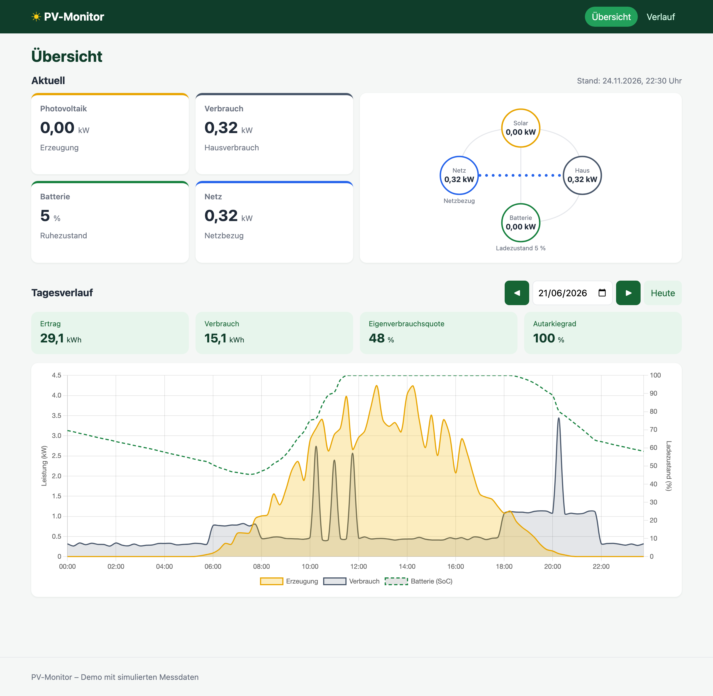
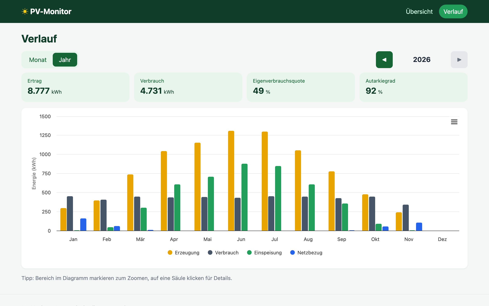
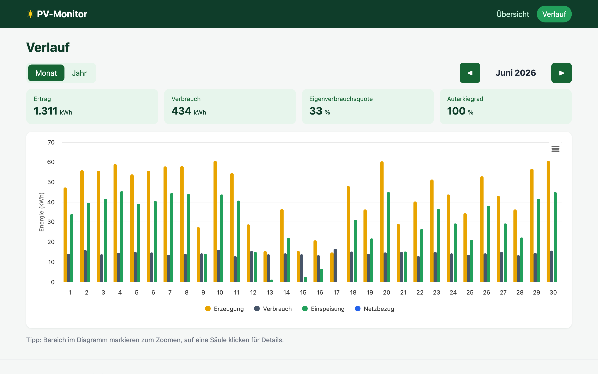
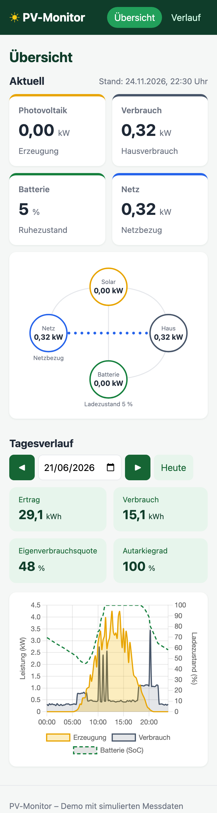

# PV-Monitor

A monitoring dashboard for a home solar system with battery storage.
It shows live values, the daily curve and the monthly / yearly history of
PV production, consumption, battery and grid – built with plain PHP, MySQL,
jQuery, Chart.js and Highcharts, without any framework.

The measurements are simulated: a 10 kWp PV plant with a 10 kWh battery in
Lower Bavaria, with realistic sunrise / sunset times, seasons, clouds and
household load. The user interface is in German.

## Screenshots

**Overview** – live values, animated energy flow, daily totals and daily chart (Chart.js)



**History** – energy per month of a year and per day of a month (Highcharts)





**Mobile (375 px)**



## Features

- **Live cards** – PV power, consumption, battery (state of charge, charging / discharging)
  and grid (import / export), refreshed every 60 seconds via jQuery AJAX
- **Energy flow** – SVG diagram with CSS-animated flows
  (solar → house / battery / grid, grid → house, battery → house); the speed depends on the power
- **Daily view** – yield, consumption, self-consumption rate and self-sufficiency rate,
  Chart.js chart with PV and consumption as areas and the battery state of charge on a second axis,
  navigation day by day (the date is kept in the URL)
- **History** – Highcharts column charts per day of a month and per month of a year
  (production, consumption, feed-in, grid import) with zoom, export (PNG, SVG, CSV, XLS)
  and drill-down (year → month → day)
- **Responsive** – mobile first, tested at 375 px, 768 px and 1280 px
- **Security** – prepared statements, output escaping, input validation,
  Content Security Policy and other security headers (see [Security](#security))

## Tech stack

| Area | Technology |
|---|---|
| Backend | PHP 8.3 (no framework), PDO |
| Database | MySQL 8.4 |
| Frontend | HTML, CSS (Grid, Flexbox, no CSS framework), JavaScript, jQuery 3.7 |
| Charts | Chart.js 4 (daily chart), Highcharts 11 (history) |
| Environment | Docker, Docker Compose, Apache |

## Getting started

Requirements: Docker with Docker Compose.

```bash
# 1. Configuration
cp .env.example .env

# 2. Start the containers (app, database, live data ticker, Adminer)
docker compose up -d --build

# 3. Fill the database with simulated data for the last 365 days up to now
docker compose exec app php bin/generate-data.php --days=365
```

Then open:

- Application: <http://localhost:8080>
- Adminer (database tool, local only): <http://localhost:8081> –
  server `db`, user and password from `.env`

The `ticker` service runs `bin/tick.php` every minute and adds a new
measurement as soon as the next 15-minute interval is reached, so the
dashboard keeps receiving "live" data.

To start again with an empty database (e.g. after changing the schema):

```bash
docker compose down -v
docker compose up -d
docker compose exec app php bin/generate-data.php --days=365
```

## How the simulation works

Each row in the table `measurements` is the average power of a 15-minute interval.

- **PV:** the sun's declination and the sunrise equation give the day length at 48.4° N
  (about 8 h in winter, 16 h in summer). Between sunrise and sunset the power follows a
  sine curve, scaled by the noon elevation of the sun (season) and a daily cloud factor.
  The cloud factor is derived from the date, so the same day always has the same weather.
- **Consumption:** base load of about 300 W, morning and evening peaks and random short
  peaks (washing machine, stove).
- **Battery:** a PV surplus charges the battery, a deficit discharges it
  (max. 5 kW, between 5 % and 100 % state of charge).
- **Grid:** covers the rest, so the energy balance is always exact:
  `pv + grid = load + battery`.

Result for one year: about 9,100 kWh production (≈ 910 kWh per kWp, typical for Bavaria)
and about 5,200 kWh consumption.

## API

All endpoints are read-only (`GET`) and return JSON.

| Endpoint | Description |
|---|---|
| `GET /api/live.php` | Latest measurement |
| `GET /api/day.php?date=YYYY-MM-DD` | All measurements of a day plus daily totals and rates (default: today) |
| `GET /api/history.php?range=month\|year&date=YYYY-MM-DD` | Energy totals per day of the month / per month of the year that contains `date` |

Invalid input returns HTTP 400 with an error message, for example
`/api/day.php?date=2026-02-31`.

## Project structure

```
├── bin/
│   ├── generate-data.php        # fills the database (--days=N)
│   └── tick.php                 # adds new measurements up to the current time
├── docker/
│   ├── mysql/init.sql           # database schema
│   └── php/
│       ├── Dockerfile           # PHP 8.3 + Apache, production php.ini
│       └── security.conf        # Apache security headers
├── docs/screenshots/
├── public/                      # document root – the only folder reachable via HTTP
│   ├── api/                     # JSON endpoints: live, day, history
│   ├── assets/
│   │   ├── css/app.css
│   │   └── js/                  # app.js (shared), overview.js, history.js
│   ├── index.php                # overview page
│   └── verlauf.php              # history page
├── src/
│   ├── bootstrap.php            # shared setup and helper functions
│   ├── Database.php             # PDO connection from environment variables
│   ├── MeasurementRepository.php  # all SQL queries
│   └── Simulator.php            # generates realistic measurements
├── templates/                   # page header and footer
├── .env.example
└── docker-compose.yml
```

## Security

- **SQL injection:** all user input is passed to MySQL via prepared statements
  (PDO with emulated prepares turned off).
- **XSS:** all output in PHP is escaped with `htmlspecialchars`; JavaScript inserts
  data only with jQuery `.text()`. A strict Content Security Policy blocks inline
  scripts as a second line of defence.
- **Input validation:** dates are checked strictly (`2026-02-31` is rejected),
  `range` against a whitelist, the API accepts only `GET`.
- **Error handling:** errors are logged, never shown to users
  (production `php.ini`, display only with `APP_ENV=development`).
- **HTTP headers:** `Content-Security-Policy`, `X-Content-Type-Options`,
  `X-Frame-Options`, `Referrer-Policy`, `Permissions-Policy`; server and PHP versions are hidden.
- **Attack surface:** only `public/` is served, configuration lives in `.env`
  (not in the repository), CDN scripts are protected with Subresource Integrity,
  chart exports are created in the browser, Adminer listens on localhost only.

For a production deployment the next steps would be HTTPS with HSTS, a separate
read-only database user for the web application and rate limiting for the API.

## Notes

- All data is simulated; the project is not connected to real devices.
- **Highcharts** is free for non-commercial use. This project is a non-commercial
  portfolio demo; commercial use of Highcharts requires a license from Highsoft.
- Chart.js and jQuery are released under the MIT license.
